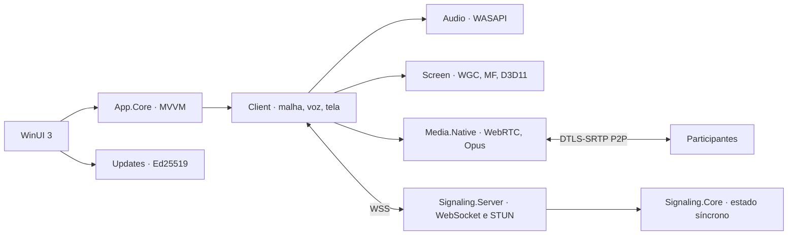

# Arquitetura e distribuição para Windows

## Arquitetura



Contratos compartilhados em `Coconut.Signaling.Contracts`. Servidor é autoridade
de admissão, administração e transmissor; núcleo sem E/S. Áudio e vídeo são
codificados uma vez e enviados aos pares admitidos/verificados. Vídeo traz a
sessão autorizada em cada pacote. Detalhes de captura, limites, handover e retomada
no [ADR 0006](adr/0006-tela-e-integracao-windows.md). Nenhum servidor de mídia,
TURN ou relay é instalado no PC.

## Instalador offline

`Coconut-<versão>-win-x64-Setup.exe` (Inno Setup) contém o mesmo payload do zip:

| Componente | Entrega |
|---|---|
| .NET 10 | Runtime local autocontido |
| WinUI/Windows App SDK 2.6.5 | DLLs e recursos locais |
| WebRTC/Opus/transitivas | vcpkg, baseline fixado no manifesto |
| Tela | `Coconut.Screen.Native.dll`; APIs WGC/MF/D3D11 do Windows |
| VC++ Runtime | Todo o conjunto CRT redistribuível do toolset, ao lado do exe |
| Atualização | NSec/libsodium e chave pública Ed25519 |
| Recursos/licenças | PRI/XBF, ICO em nove tamanhos, GPLv3 e avisos de terceiros |

Windows 11 x64 (build 22000+); ARM64 não distribuído. Em Windows N, componentes
de mídia devem estar disponíveis. Não exige SDK, .NET, Visual Studio, vcpkg ou
Inno no PC do usuário. Instalação offline; chamada exige sinalização acessível.

Instala por usuário em `%LOCALAPPDATA%\Programs\Coconut`, sem UAC; menu Iniciar,
atalho opcional e desinstalação. AppId fixo permite atualizar preservando
`%LOCALAPPDATA%\Coconut`. Registra `coconut://` em HKCU com argumento entre aspas.
Inicialização automática vem desligada; se habilitada pelo app, instalador
atualiza seu caminho. Desinstalação remove registros somente se ainda forem seus.
Fechar janela mantém app na bandeja; sair pela bandeja/engrenagem encerra.

Sem `-Server`, pacote público não inclui endereço particular. Pessoa informa
servidor em Avançado. Pacotes privados usam sufixo `-servidor`; nunca publicar.
Padrões antigos do diretório do app são removidos na instalação para evitar
servidor residual. Preferências pessoais separadas são preservadas.

## Reproduzir

Windows x64, SDK do `global.json`, Build Tools com C++/Windows SDK e componente
CMake. Build da ponte nativa é integrado ao projeto `Coconut.Screen`; usa CMake
incluído no Visual Studio. Nativos WebRTC/Opus:

```powershell
git clone https://github.com/microsoft/vcpkg C:\Dev\tools\vcpkg
git -C C:\Dev\tools\vcpkg checkout 8f363bdc11359ede4bc51e5eb32a2617538049c8
C:\Dev\tools\vcpkg\bootstrap-vcpkg.bat -disableMetrics
C:\Dev\tools\vcpkg\vcpkg.exe install --x-manifest-root=native --x-install-root=native/vcpkg_installed --triplet x64-windows
dotnet build Coconut.slnx -c Release
dotnet test Coconut.slnx -c Release --no-build
powershell -NoProfile -ExecutionPolicy Bypass -File deploy\publish-installer.ps1
```

`VERSION` é a versão padrão única. `-Version x.y.z` gera pacote explícito.
Inno 7.1.1 oficial é obtido com SHA-256 fixado, instalado em `artifacts/tools`;
`-InnoCompilerPath` permite compilador existente. `publish-app.ps1` verifica
DLLs/recursos/licenças antes do zip. Saída: `artifacts/app`. Ícone SVG/PNG/ICO
em `src/Coconut.App/Assets`, gerador WPF em `deploy/windows/build-icon.ps1`.

## Assinar atualização e publicar

Manifestos Ed25519 são diferentes de certificado Authenticode. A chave privada
DPAPI CurrentUser fica em `%LOCALAPPDATA%\Coconut\signing\release-key.dpapi`;
a pública é versionada em `src/Coconut.Updates/release-public-key.txt`.
Não regenerar a identidade existente. Não publicar chave privada ou backup.
Outro mantenedor pode compilar pacote não assinado; ele não será aceito pelo
atualizador oficial sem migração explícita de confiança.

```powershell
# Somente primeira criação de identidade, antes de distribuir a chave pública:
dotnet run --project tools/Coconut.Release -- init src/Coconut.Updates/release-public-key.txt
# Mantenedor com a identidade existente:
powershell -NoProfile -ExecutionPolicy Bypass -File deploy/publish-installer.ps1 -SignUpdate
```

`-SignUpdate` recusa `-Server`, assina `coconut-update.json` e inclui manifesto
no SHA256SUMS. App verifica feed GitHub (inclui pré-lançamentos), assinatura,
versão/runtime/validade/URL, tamanho e hash antes de executar, com nova conferência
sob bloqueio de escrita. Checa ao abrir e a cada seis horas. Aplicação exige clique
e aguarda fim de chamada/entrada; não interrompe uma chamada para atualizar.

Validar pacote, revisar diff, atualizar evidências, commit e tag `v<versão>`.
Publicar quatro assets públicos: Setup, zip, SHA256SUMS e `coconut-update.json`,
com notas em `docs/releases`. Fontes correspondentes ficam na tag do GitHub.
Nunca substituir binários de tag existente. Publicação exige autorização.

## QA isolada e limites

`COCONUT_PROFILE_DIRECTORY` aceita diretório absoluto local para perfis de teste;
separa preferências, logs, broker e cache de atualização. O padrão continua um
perfil por usuário. Não mudar inicialização do Windows com perfis de QA.
`tools/Coconut.Release verify-apply <manifesto> <setup> <baseline> installed`
verifica assinatura/hash e atualiza a instalação registrada se a baseline confere.
Exige todos os processos Coconut fechados. Não usar diretório alternativo do mesmo
AppId sobre uma instalação real: isso redirecionaria seu registro de desinstalação.

Não há Authenticode, portanto SmartScreen pode avisar. Windows limpo, outra GPU,
redes distintas e estabilidade prolongada não estão validados. Evidências:
[MVP 0.3](benchmarks/2026-11-17-mvp.md), [instalador 0.2](benchmarks/2026-11-16-instalador-windows.md).
