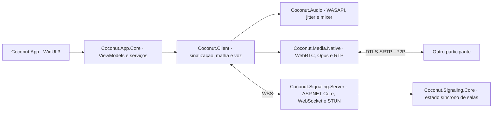

# Arquitetura e distribuição para Windows

## Arquitetura existente



`Coconut.Signaling.Contracts` define as mensagens compartilhadas. O servidor é a autoridade de admissão e administração; o núcleo não faz E/S. ViewModels e persistência ficam separados da janela WinUI. WASAPI captura/reproduz áudio; o cliente codifica uma vez com Opus e envia a todos os pares admitidos. Nenhum servidor de mídia, TURN ou relay é instalado no PC do usuário. O compartilhamento de tela, a bandeja e a ativação pelo protocolo de convite ainda estão pendentes.

## Solução de instalação

Um único `Coconut-<versão>-win-x64-Setup.exe`, produzido pelo Inno Setup, contém o payload autocontido que também gera o zip portátil:

| Componente | Entrega |
|---|---|
| .NET 10 | `dotnet publish --self-contained true`, runtime local |
| Windows App SDK/WinUI 2.6.5 | `WindowsAppSDKSelfContained=true`, DLLs e recursos locais |
| WebRTC/Opus e dependências transitivas | DLLs compiladas pelo vcpkg, baseline fixado em `native/vcpkg.json` |
| Visual C++ Runtime | `msvcp140.dll`, `vcruntime140.dll`, `vcruntime140_1.dll` ao lado do executável |
| Recursos | `Coconut.pri`, views XBF, ícone ICO em nove tamanhos |
| Licenças e fontes | GPLv3, copyrights dos nativos, avisos e link para a tag correspondente |

O usuário não precisa instalar SDK, .NET, Visual Studio, vcpkg ou Inno Setup. O instalador funciona offline; a chamada exige internet e um servidor de sinalização acessível. Windows 11 x64 (build 22000 ou superior) é obrigatório; ARM64 não é distribuído nesta versão.

Instalação por usuário em `%LOCALAPPDATA%\Programs\Coconut`, sem UAC, com menu Iniciar, atalho opcional na área de trabalho e entrada de desinstalação. `AppId` permanece fixo entre versões: executar o instalador novo atualiza a instalação existente. O instalador pede o fechamento do app quando necessário. Preferências e logs ficam separados em `%LOCALAPPDATA%\Coconut` e são preservados ao atualizar/desinstalar. Não registra `coconut://`, pois a ativação ainda não está implementada.

O endereço particular do servidor não entra na release pública. Sem `-Server`, a pessoa informa o endereço na tela inicial. Pacotes privados recebem sufixo `-servidor`; nunca anexar esses arquivos a uma release pública. Ao reinstalar, um arquivo de padrões anterior é removido antes de copiar o payload novo para evitar configuração residual.

## Reproduzir o pacote

Ambiente de desenvolvimento: Windows x64, SDK do `global.json`, Visual Studio Build Tools com C++/Windows SDK e redistribuíveis do toolset. Para reproduzir os nativos atuais:

```powershell
git clone https://github.com/microsoft/vcpkg C:\Dev\tools\vcpkg
git -C C:\Dev\tools\vcpkg checkout 8f363bdc11359ede4bc51e5eb32a2617538049c8
C:\Dev\tools\vcpkg\bootstrap-vcpkg.bat -disableMetrics
C:\Dev\tools\vcpkg\vcpkg.exe install --x-manifest-root=native --x-install-root=native/vcpkg_installed --triplet x64-windows
dotnet test Coconut.slnx -c Release
powershell -NoProfile -ExecutionPolicy Bypass -File deploy\publish-installer.ps1
```

`VERSION` é a versão única padrão de todos os projetos e pacotes. `-Version x.y.z` permite gerar um pacote explícito. `publish-installer.ps1` obtém o compilador **Inno Setup 7.1.1** oficial, verifica um SHA-256 fixado antes de executá-lo e o instala em `artifacts/tools`; pode receber `-InnoCompilerPath` para usar um compilador existente. Fontes: [download oficial](https://jrsoftware.org/inno-setup/downloads), [release e digest do compilador](https://github.com/jrsoftware/issrc/releases/tag/is-7_1_1), [instalação sem administrador](https://jrsoftware.org/is6help/topic_setup_privilegesrequired.htm).

`publish-app.ps1` verifica arquivos essenciais, recursos WinUI e runtimes antes de comprimir o payload. O instalador usa esse mesmo diretório. A saída em `artifacts/app/` contém Setup, zip e `SHA256SUMS`. O ícone original é `src/Coconut.App/Assets/Coconut.svg` (GPLv3, como o projeto); `deploy/windows/build-icon.ps1` regenera PNG e ICO usando WPF, sem ferramentas gráficas externas.

## Publicar

Validar o instalador localmente, revisar `git diff`, atualizar estado/evidências, fazer commit e enviar a tag `v<versão>`. Publicar apenas os três arquivos públicos como pré-lançamento, junto das notas em `docs/releases/`. O código correspondente fica disponível na tag e nos arquivos de fontes automáticos do GitHub. Não republicar binários sob uma tag existente.

## Limites

Não há assinatura Authenticode nem atualização automática verificada. SHA-256 ajuda a conferir integridade, mas não substitui assinatura de editor. A atualização desta versão é manual. Assinatura requer um certificado/identidade do mantenedor; não há credencial de assinatura configurada. Um Windows limpo e outra máquina/rede ainda precisam de validação; os testes locais não comprovam áudio entre duas pessoas em redes distintas. Resultados observados estão em [evidências da versão 0.2.0](benchmarks/2026-11-16-instalador-windows.md).
